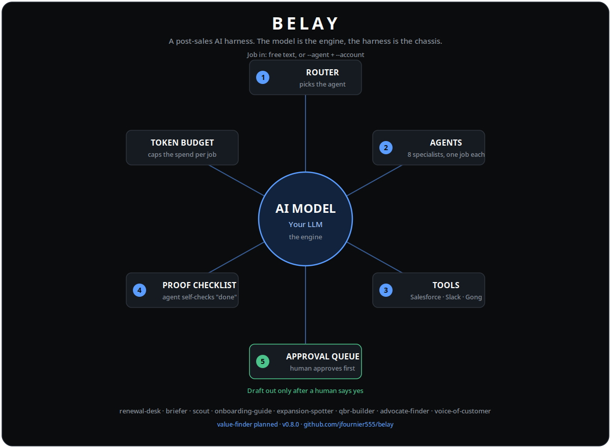

# Belay

**A post sales AI harness.**


Post-sales is a hard climb. Every account is a steep peak: the renewal, the expansion, proving the value is real. The reps climbing them are doing it with a full book and no rope. Belay is the rope and the harness. It is everything around the model: routing, tools, memory, approvals. The model is the engine, Belay is the chassis, and the dashboard is what post sales teams operate from. It keeps you from falling while you climb,

Belay is the sequel to ["AI is taking the admin. The judgment is the job."](https://jfournier.net/articles/ai-admin-judgment/): the article's "the wiring is the job" productized.

## First run

```bash
git clone https://github.com/jfournier555/belay.git
cd belay
python3 -m venv .venv
source .venv/bin/activate
pip install -r requirements.txt
pip install -e .
cp .env.example .env
```

Python 3.11 or newer. The demo needs no credentials and no network: stub data plus the stub LLM.

```bash
python -m harness.run run --agent renewal-desk --account "Acme Corp" --stub --show
```

The account is the unit: every run names one account, and every agent works from it. Connect each source once in `.env`; there is no per-agent or per-subaccount setup, subaccounts follow the account hierarchy in your CRM.

To go live, fill in `.env` with the credentials you have, starting with Salesforce and Slack, then run without `--stub`:

```bash
python -m harness.run run --agent renewal-desk --account "Acme Corp"
```

Missing credentials fall back to stub mode for that connector, so you can connect one source at a time.

## How it works

```
Job (free text or --agent + --account)
  -> Router (keyword first, small-model LLM only when ambiguous)
  -> Specialist agent (1 of 9, all implemented: the original 8 in v0.7,
     value-finder in v0.9.0)
  -> Tools (9 connectors, summary-first results)
  -> Draft
  -> Proof checklist (the agent self-checks "done" before queueing)
  -> Approval queue (a human approves, rejects, or edits)
  -> Only an approved draft leaves the harness
```



Three rules, enforced in code:
1. **Model-agnostic.** Any LLM that speaks the OpenAI-compatible chat API
   works: OpenAI, Ollama, vLLM, anything. Point `HARNESS_LLM_BASE_URL` at
   it. No vendor lock-in.
2. **Low token use is real architecture.** Small model for the router.
   Tools return summaries, never raw transcripts. A per-job token budget
   stops one bad tool call from blowing up the context window.
3. **A human reads the draft, not the whole thread.** No agent output is
   sent, posted, or acted on directly. Every draft goes to the approval
   queue first. Nothing writes back to Salesforce until a human approves
   it. The queue gates writes as well as sends; no live agent writes
   back today, and write-back (v1.3.0) is approval-gated by design.

## Proof checklist

Each agent self-checks its draft against a proof checklist before it
reaches the queue, and every draft carries clickable deep links to the
records it cites, so the reviewer checks the source, not a score. The
checklist is a completeness gate, not a grade: each item is a fact the
draft must contain or a source it must have gathered, and one item
checks the draft carries source links at all. A failed item is a flag,
never a block: the draft still goes to the queue either way, and human
approval remains the final gate. No aggregate score is shown anywhere:
a score would let the reviewer trust the number instead of opening the
record.

The links are built by the harness, never by the model: the Salesforce
tools return record ids and the instance URL, the Slack tool carries
each message's permalink, and the harness turns those into Lightning
record links and Slack permalinks. The model is never shown a URL and
is told never to write one, so a link can never be hallucinated. In
stub mode the links point at clearly fake hosts (`.invalid`), so a
demo link can never be mistaken for a real record.

## Quick start

```bash
pip install -r requirements.txt

# Demo with no credentials and no network: stub data + stub LLM.
python -m harness.run run --agent renewal-desk --account "Acme Corp" --stub --show

# Free-text routing (the router picks the agent).
python -m harness.run run --text "draft a renewal plan for Acme Corp" --stub

# Value report with quantified time saved. The rate and the hours are
# explicit inputs, never assumed: --hourly-rate, or
# HARNESS_LOADED_HOURLY_RATE in the environment.
python -m harness.run run --agent value-finder --account "Acme Corp" --stub --hourly-rate 150 --hours-saved 10 --show

# See the nine agents and the registered tools.
python -m harness.run agents
python -m harness.run tools

# Review and approve the draft.
python -m harness.run approvals list
python -m harness.run approvals show <id>
python -m harness.run approvals approve <id>
```

## With real credentials

Copy `.env.example` to `.env` and fill in what you have. Everything is
optional: missing credentials fall back to stub mode for that connector,
and a missing LLM key falls back to the stub LLM.

```bash
cp .env.example .env
# HARNESS_LLM_API_KEY=...        (OpenAI, or any OpenAI-compatible key)
# SALESFORCE_INSTANCE_URL=...    (e.g. https://mycompany.my.salesforce.com)
# SALESFORCE_ACCESS_TOKEN=...    (OAuth access token)
# SLACK_BOT_TOKEN=...            (xoxb-...)
```

Then run without `--stub`:
```bash
python -m harness.run run --agent renewal-desk --account "Acme Corp"
```

## The nine agents

Each agent owns one job, not a schedule. Cadence is the scheduler
(v1.4.0), a separate architecture piece.

| Agent | Status | What it does |
|---|---|---|
| renewal-desk | implemented | Drafts a renewal plan: health, risks, next steps. |
| briefer | implemented | Drafts a pre-meeting brief: snapshot, changes, questions. |
| scout | implemented | Finds new information: stakeholders, org changes, hiring signals. |
| onboarding-guide | implemented | Drafts onboarding plans and first-value checklists. |
| expansion-spotter | implemented | Finds expansion openings: usage gaps, new teams. |
| qbr-builder | implemented | Drafts a quarterly business review: outcomes, adoption, risks. Composes from prior renewal-desk, expansion-spotter, and voice-of-customer drafts when they exist; gathers directly otherwise. |
| advocate-finder | implemented | Finds champions and advocates: who uses it most, who praises it, how much influence each carries, and which champions changed jobs. |
| voice-of-customer | implemented | Summarizes customer feedback: requests, pain points, sentiment. |
| value-finder | implemented | Finds realized and unrealized outcomes in money or time: time saved, revenue protected, gaps not yet captured. Every dollar figure is labeled measured or modeled with its basis. |

## Composition

Agents build on each other's outputs. The approval queue is the only
channel between them: no new store, no new framework.

The first use is qbr-builder. When prior drafts from renewal-desk,
expansion-spotter, and voice-of-customer exist for the account, the
QBR is built from those drafts instead of re-gathering the same
context. Only the account record is gathered directly. The composed
draft carries the deep links from its source drafts, and a
harness-written line names the agents it was composed from.

When no prior drafts exist, qbr-builder gathers directly, exactly as
before. Composition is an optimization, never a hard dependency.

## Memory

The harness remembers what the human decided. Every decision in the
approval queue is recorded for that draft's account: approved,
rejected, and edited. An edit stores the correction itself, a diff
when the change is small, the edited text when the draft was
rewritten. The next run for the same account loads that memory as
context, newest first, bounded by the token budget. Fresh tool results
still come first; memory only spends what the budget has left.

Memory never crosses accounts, and it is local only: one JSON file
(`memory.json`, `HARNESS_MEMORY_FILE` to move it). Nothing in it is
ever sent anywhere. At most 50 records are kept per account.

```bash
# Run cold, without memory.
python -m harness.run run --agent renewal-desk --account "Acme Corp" --no-memory

# Inspect one account's memory, or forget it.
python -m harness.run memory show "Acme Corp"
python -m harness.run memory clear "Acme Corp"
python -m harness.run memory accounts
```

## Dashboard

The dashboard is the UI the CSM operates from. It reads the live
approval queue file and shows the numbers from real harness state:
accounts watched, at-risk drafts, drafts ready, advocates found, the
approval queue with each draft's completeness check and source links, source status,
agent last-run state, the event log, and the token budget. When the
queue is empty it says so; no number is ever invented. Everything is a
draft until I say send.

```bash
python -m harness.run dashboard
# or: python -m harness.dashboard
```

Then open http://127.0.0.1:8000. Local-only, localhost, no auth. Approve
and reject buttons call the same approval queue the CLI uses.

## Planned architecture (v1.x)

Architecture first, then agents. These ship as minor releases before the
agent candidates below.

| Piece | Target | What it will do |
|---|---|---|
| dashboard | v0.8.0 (shipped) | Local web UI over the live approval queue: stat strip, queue with completeness checks, source links, and approve/reject, sources, agents, event log, token budget. Pulled forward ahead of v1.0.0 at Justin's Nov 20 decision. |
| composition | v1.1.0 (shipped) | Agents build on each other's outputs; the QBR is built from renewal-desk, expansion-spotter, and voice-of-customer drafts, falling back to direct gathering when no prior drafts exist. |
| memory | v1.2.0 (shipped) | Persistent memory across runs: past drafts, decisions, and corrections per account, injected as context next run, bounded by the token budget. Capture in the approval queue; edits store the correction itself. Local only, never crosses accounts. |
| write-back | v1.3.0 | The first write tools plus approval-gated execution. The Salesforce updater agent is the first use. |
| scheduling | v1.4.0 | A daemon that runs the harness on its own, so watch agents actually watch. |
| MCP client | v1.5.0 | A harness-side MCP client that picks up MCP servers the user already has connected. |

## Planned agents

| Agent | Target | What it will do |
|---|---|---|
| risk-watcher | v1.6.0 | Watches continuously for churn signals: usage drops, ticket spikes, champion departure, sponsor disengagement. When a champion leaves, it asks whether the org mandate changed. |
| escalation-manager | v1.7.0 | Gathers case history, customer impact, and internal status; drafts the exec update and customer comms. |
| competitive-defense | v1.8.0 | Watches for displacement risk: competitor mentions, evaluation signals, champion doubt. |
| stakeholder-mapper | v1.9.0 | Builds the relationship map: users, champions, economic buyers, blockers, and how they connect. Records influence, not just titles. |
| case-triage | v1.10.0 | Classifies incoming cases by severity and drafts the engineering bug report. |

## Connectors

| Connector | Status | Tools |
|---|---|---|
| Salesforce | v0.2 | `salesforce_get_account`, `salesforce_list_opportunities`, `salesforce_list_cases` |
| Slack | v0.2 | `slack_search_messages`, `slack_list_channels`, `slack_get_thread` |
| Gong | v0.8.2 | `gong_list_calls`, `gong_get_call_summary`, `gong_search_transcripts` |
| HubSpot | v0.8.3 | `hubspot_get_company`, `hubspot_list_deals`, `hubspot_list_tickets` |
| Gmail | v0.8.4 | `gmail_search_messages`, `gmail_get_thread` |
| Zoom | v0.8.5 | `zoom_list_recordings`, `zoom_get_recording_summary`, `zoom_search_transcripts` |
| Zendesk | v0.8.6 | `zendesk_list_tickets`, `zendesk_search_tickets`, `zendesk_get_ticket` |
| Linear | v0.8.7 | `linear_list_issues`, `linear_search_issues`, `linear_get_issue` |
| Champify | v0.8.8 | `champify_list_champions`, `champify_list_job_changes`, `champify_get_champion` |

Each connector exposes its tools two ways, from one implementation
(`tools.py`): in-process, through the harness tool registry (the v0.2 path),
and as a standalone MCP server (`server.py`, FastMCP over stdio) that any
MCP-capable LLM can call. Run a connector as an MCP server with:

```bash
python -m connectors.salesforce.server
python -m connectors.slack.server
python -m connectors.gong.server
python -m connectors.hubspot.server
python -m connectors.gmail.server
python -m connectors.zoom.server
python -m connectors.zendesk.server
python -m connectors.linear.server
python -m connectors.champify.server
```

Calling the MCP servers from the harness via an MCP client (instead of
in-process) is a v1.5.0 item. The tool functions are already written once
and shared, so the cutover is a client, not a rewrite.

## What is real vs scaffolded (v1.0.0 honesty)

**Real, tested (253 unit tests, all passing):**
- Router (explicit, keyword, small-model LLM, default), tool registry
  (summary-first), approval queue (file-backed, persists), token budget,
  stub LLM, OpenAI-compatible LLM client (tested with a mocked transport).
- All nine agents, end to end, in stub mode: renewal desk, briefer,
  expansion spotter, onboarding guide, scout, qbr builder, advocate
  finder, voice of customer, and value finder.
- Proof checklist: every agent self-checks its draft against a "done"
  checklist before queueing, and every draft carries clickable deep
  links to the records it cites; failures are flagged in the draft
  metadata and shown in `approvals show`, never a block, and no
  aggregate score is shown anywhere.
- Salesforce, Slack, Gong, HubSpot, Gmail, Zoom, Zendesk, Linear, and Champify MCP servers: verified over the real MCP protocol
  (a client connected over stdio, listed tools, called one, got a result).
- The demo loop (`run` -> draft -> approval queue) in stub mode.
- The dashboard (v0.8.0): local FastAPI server reading the live queue
  file. Stat strip, approval queue with completeness checks, source
  links, and working approve/reject, source status, agent last-run
  state, event log, token budget. Every number comes from harness
  state; an empty queue renders an honest empty state.

**Written, not verified against a live system:**
- The live Salesforce REST/SOQL calls, the live Slack Web API calls,
  the live Gong REST API calls, the live HubSpot CRM API calls, the
  live Gmail API calls, the live Zoom API calls, the live Zendesk API
  calls, the live Linear GraphQL API calls, and the live Champify API calls. They are real code, written against the
  documented APIs, but no credentials were available while building
  v0.2 (Salesforce/Slack), v0.8.2 (Gong), v0.8.3 (HubSpot), v0.8.4
  (Gmail), v0.8.5 (Zoom), v0.8.6 (Zendesk), v0.8.7 (Linear), or v0.8.8 (Champify), so they have not run against a real org, workspace, Gong
  account, HubSpot portal, mailbox, Zoom account, Zendesk instance, Linear workspace, or Champify account. Treat them as "written,
  not verified" until someone runs them with real credentials. Stub mode
  is what runs in the demo and the tests. One caveat, for Champify only:
  Champify publishes no public API reference, so its endpoint shapes
  are assumed from the product's data model, not from documentation,
  and must be corrected against the real API the first time a key is
  available.

**Scaffolded / planned, not built:**
- v1.0.0, the CLI complete, shipped after value-finder (v0.9.0).
- Architecture pieces, planned: composition, memory, write-back,
  scheduling, MCP client. They ship first as minor releases in the v1
  line (v1.1.0–v1.5.0).
- New agents, planned: risk-watcher, escalation-manager,
  competitive-defense, stakeholder-mapper, case-triage. They ship as minor
  releases in the v1 line (v1.6.0–v1.10.0).
- The MCP client inside the harness (v1.5.0). Until then, v1 calls
  connector tools in-process; the MCP servers are standalone.

## Adding a connector

Copy `connectors/slack/` to `connectors/<name>/`. Write the pure tool
functions in `tools.py` (plain functions, return dicts, summary-first).
Wrap them in `server.py` with FastMCP. Register them in
`harness/run.py` `build_registry()`. Add the env vars to `.env.example`.
See `connectors/base.py` for the pattern, and `connectors/gong/` for a
worked example of a built connector.

## Related work

- [MCP Readiness Checker](https://jfournier.net/tools/mcp-readiness/):
  scores whether a team is ready to run agents against their data. Run
  it before wiring this harness to a real org.
- ["AI is taking the admin. The judgment is the job."](https://jfournier.net/articles/ai-admin-judgment/):
  the positioning piece this harness follows from.

## License

MIT. See [LICENSE](LICENSE).
